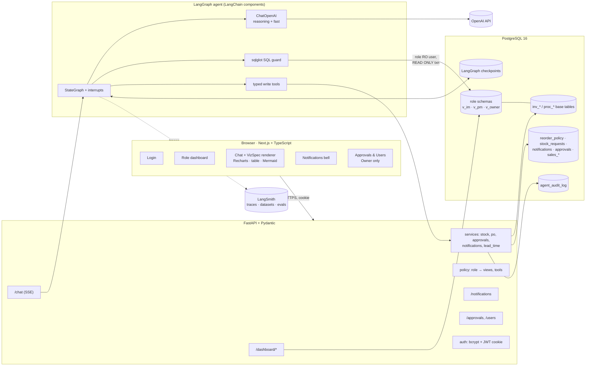
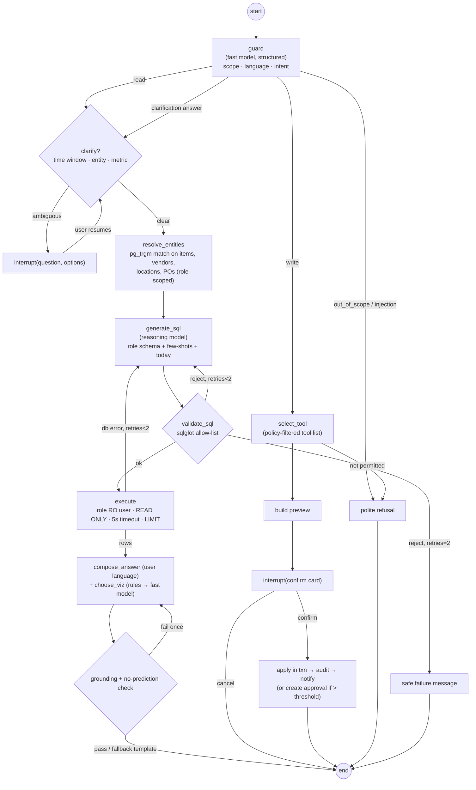
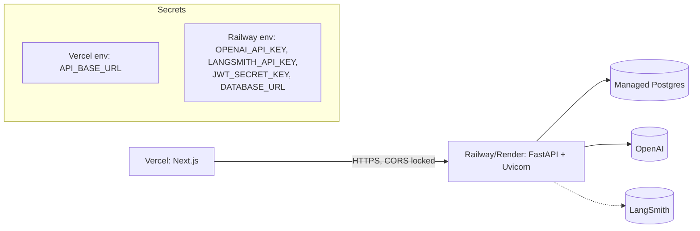
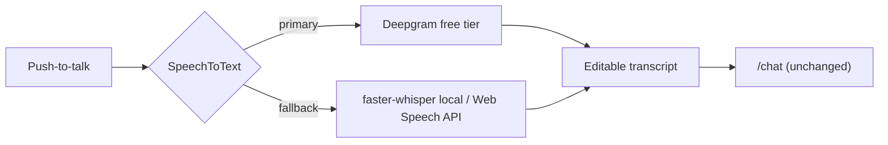

# Architecture — InventoryMantra

## 1. System overview



**Where each technology is used**

| Tech | Used for |
|---|---|
| **Next.js + TS** | Pages: `/login`, `/dashboard`, `/chat`, `/notifications`, `/approvals`, `/users`. The middleware guard is for UX only. It renders `VizSpec` (Recharts bar/line/pie/stacked, KPI tiles, shadcn tables, Mermaid flows) and reads SSE for streaming status and answers. |
| **FastAPI** | HTTP API, SSE streaming, dependency-injected `current_user` → `policy`, background lead-time scan (APScheduler). |
| **Pydantic** | Request/response models, `Settings` (secrets as `SecretStr`), agent state pieces, `VizSpec`, tool args, structured LLM outputs. |
| **LangGraph** | The agent as a `StateGraph`: conditional routing (read / write / clarify / out-of-scope), `interrupt()` for clarification and write confirmation, `PostgresSaver` checkpointer for per-thread memory and resume. |
| **LangChain** | `ChatOpenAI` models, `ChatPromptTemplate`s, `with_structured_output` for guard/clarify/viz/SQL, `@tool` typed write tools, few-shot example selectors. |
| **LangSmith** | Tracing every run (tags `role`, `lang`, `route`; metadata `thread_id`, `user_id` hash), a dataset of the golden corpus, evaluators (execution accuracy, RBAC leak, clarify, viz, language, grounding, no-prediction), and comparing experiments between prompt or model changes. |
| **PostgreSQL** | Business data, role views, read-only login roles, `pg_trgm` for entity matching, checkpoints, audit, notifications. |

## 2. Agent graph (LangGraph)



**State** (Pydantic/TypedDict): `messages`, `user {id, role}`, `lang`, `intent`, `resolved_entities`, `sql`, `sql_attempts`, `rows`, `columns`, `answer`, `viz`, `pending_action`, `route`.

**Role scoping inside the graph:** the role is injected from the authenticated session into the graph config, never from the user's message. The schema context, entity search scope, tool list and DB connection are all chosen from that role.

## 3. Read request sequence

```mermaid
sequenceDiagram
  participant U as User (PM)
  participant W as Next.js
  participant A as FastAPI /chat
  participant G as LangGraph
  participant O as OpenAI
  participant D as Postgres (rms_pm_ro)
  participant L as LangSmith
  U->>W: "Spend by vendor this month"
  W->>A: POST /chat {thread_id, text} (cookie)
  A->>A: auth → user.role = procurement_manager
  A->>G: invoke(state, config{role, thread_id}) (SSE open)
  G->>O: guard (fast) → read, lang=en
  G->>G: clarify → clear ("this month" = 2026-09-01..30)
  G->>O: generate_sql (reasoning, v_pm schema)
  G->>G: sqlglot validate (allow-list v_pm.*)
  G->>D: SELECT … (READ ONLY, 5s)
  D-->>G: rows
  G->>O: compose answer
  G->>G: choose_viz → bar; grounding ✓
  G-->>A: answer + VizSpec + rows
  A-->>W: SSE answer event
  W-->>U: text + bar chart
  G-->>L: full trace (tags role/lang/route)
```

## 4. Write request sequence (IM stock adjustment)

```mermaid
sequenceDiagram
  participant U as IM
  participant G as LangGraph
  participant S as Services
  participant D as Postgres
  U->>G: "Add 3 AC Contactor to 132-2"
  G->>G: guard → write; select_tool = record_stock_movement (allowed for IM)
  G->>D: resolve item & location
  G-->>U: interrupt: confirm card (item, location, +3, new qty)
  U->>G: Confirm
  G->>S: record_stock_movement(args)
  S->>D: BEGIN; insert inv_transactions; update inv_current_stock; insert agent_audit_log; COMMIT
  S->>D: insert notifications (PM: "IM added 3 pcs AC Contactor to 132-2")
  G-->>U: "Done: 3 pcs added. 132-2 now has N."
```

For a PM purchase order above the threshold, `apply` creates the PO with status `pending_approval` plus an `approvals` row. The Owner is notified. The Owner's decision updates the PO and notifies the PM with the result only.

## 5. Data model additions

| Table | Purpose |
|---|---|
| `reorder_policy(item_id, location_id?, min_level, reorder_qty, lead_time_days, safety_stock, preferred_vendor_id, source)` | Drives lead-time alerts |
| `stock_requests(id, item_id, qty, needed_by, note, status, requested_by, handled_by, po_id?)` | IM → PM requests |
| `approvals(id, entity_type, entity_id, requested_by, status, decided_by, decided_at, note)` | Owner approval queue |
| `notifications(id, recipient_user_id?, recipient_role?, type, title, body, payload, created_at, read_at)` | Role-scoped alerts |
| `sales_orders`, `sales_order_lines` (demo) | Revenue and margin for Owner questions |
| `app_users` (or reuse `users`) | Fresh demo users per role |

Role views (examples):
- `v_im`: `items` (with explicit `Uncategorised`), `stock_by_location`, `stock_movements` (no unit_cost), `locations`, `issue_targets`, `inbound_by_item` (item, PO number, pending_qty, expected date; no vendor or price), `my_stock_requests`, `reorder_status` (without vendor).
- `v_pm`: all of `v_im` (movements with unit cost), plus `vendors`, `purchase_orders` (with `days_overdue`), `po_lines`, `po_receipts`, `payment_tranches`, `unexpected_receipts`, `regularisations`, `stock_requests` (all), `reorder_status` (with preferred vendor), `spend_by_vendor_month`, `my_approval_results`, `my_audit_log` (a security-barrier view filtered by the `app.user_id` session setting, which the API sets per request).
- `v_owner`: all of `v_pm` except the `my_*` views, plus `sales_orders`, `sales_lines`, `margins_by_quarter`, `approvals`, `users` (no hashes), `audit_log`.

## 6. Deployment view



Local dev: `docker compose` (Postgres) + `uv run uvicorn` + `next dev`. Secrets come from `.env` only.

## 7. Post-scope: voice


